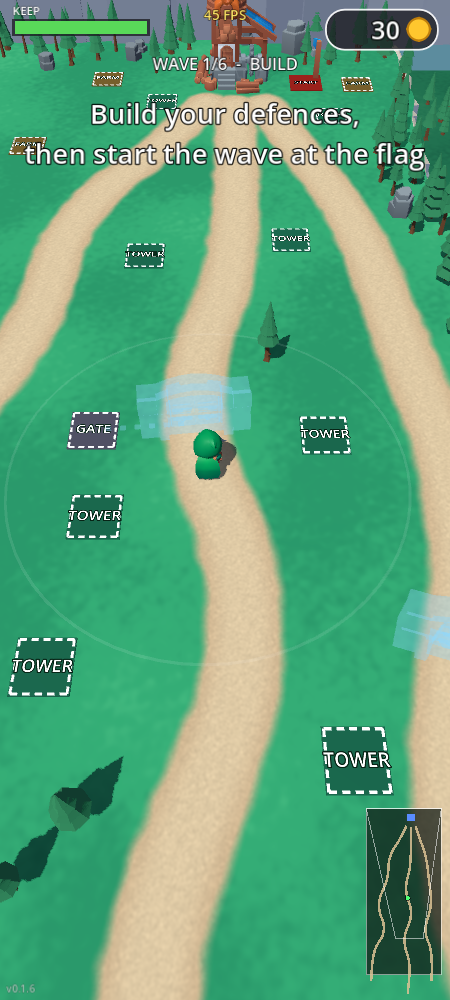
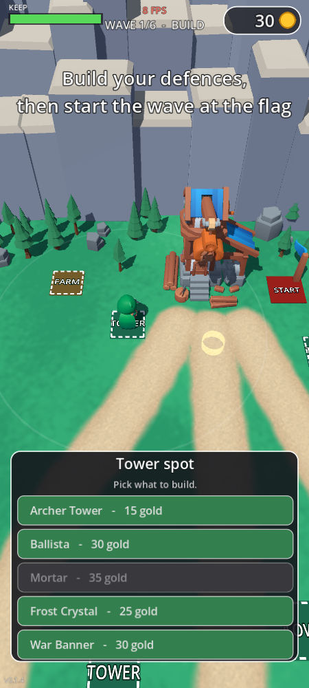
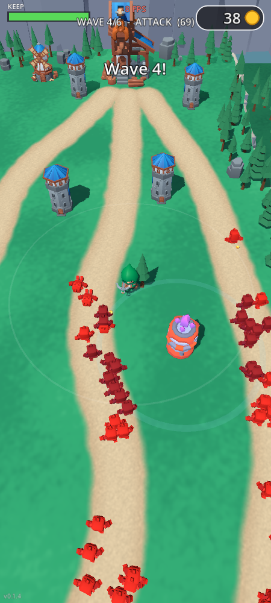

# RogueShot TD (RogueShot Tower Defense, RSTD)

A 3D low-poly **tower defense for Android phones (and Windows PC)**, built
with [Godot 4.7](https://godotengine.org). It started as a recreation of the
tower-defense level shown in *Kingshot*'s ads and now borrows its defense
system from *Thronefall*: a hero who walks the map, fixed building spots
with different tower roles, and waves on three lanes.

A personal project, built by directing Claude (Claude Code) with free
CC0 asset packs. Not published anywhere.

  
  
  

## How to play

- **Move** by dragging anywhere on the screen (a floating joystick; on PC,
  drag with the mouse or use WASD / arrow keys). The hero shoots the nearest
  enemy by himself, also while moving.
- **Pick up gold** dropped by enemies by walking over it.
- **Build phase:** walk onto a spot and its menu pops up; tap to build or
  upgrade (3 levels each). Walk onto the red **START** pad by the keep to see
  what the next wave sends down each lane and to start it.
- **Attack phase:** no building. Survive the wave; farms pay out and gates
  are repaired afterwards.
- **Win** by clearing all 6 waves. **Lose** when the keep's HP runs out.

| Building | Spot | What it does |
|---|---|---|
| Archer Tower | tower | Cheap, quick single-target arrows |
| Ballista | tower | Slow heavy bolt that pierces a whole line |
| Mortar | tower | Lobs boulders that splash a group; can't hit up close |
| Frost Crystal | tower | Pulse that slows everything nearby |
| War Banner | tower | No attack; towers and the hero in its ring attack faster |
| Farm | farm | Gold after every wave |
| Gate | gate | Blocks its lane until broken; repaired after each wave |

Enemies: grunts, armoured soldiers, fast runners and giant brutes.

## Running it

- **PC:** open the folder in Godot 4.7 and press Play, or export with
  `./build.sh export` (writes a Windows `.exe`).
- **Android:** `./build.sh apk` builds a debug APK (needs the Android SDK
  and JDK set up in Godot's editor settings). Copy it to the phone and tap
  it; newer builds install over older ones.

`./build.sh` also runs the headless rule tests (`test`), a bot balance run
(`sim`), screenshots (`shot`) and native benchmarks (`native --bench=10`);
see the comments at its top. Project notes for development are in
[CLAUDE.md](CLAUDE.md), the game design in [docs/DESIGN.md](docs/DESIGN.md).

## Tech notes

- All game rules live in plain scripts without nodes (`scripts/sim.gd`,
  `horde.gd`), so tests and balance runs play whole levels headlessly in
  seconds.
- Hundreds of animated enemies are drawn as one MultiMesh per type, with
  their animations baked into vertex-animation textures
  (`tools/bake_vat.gd`, `shaders/vat.gdshader`). This holds the 60 fps cap
  on a mid-range phone (Mali-G68).
- Compatibility renderer (OpenGL ES 3) on every platform.

## Credits

- 3D models: [Kenney](https://kenney.nl) (Tower Defense Kit, Mini Dungeon,
  Mini Arena, Nature Kit), [Kay Lousberg / KayKit](https://kaylousberg.com)
  (Adventurers, Medieval Hexagon, Forest Nature, Dungeon Remastered),
  [Quaternius](https://quaternius.com) (Giant) — all CC0.
- Sound effects: Kenney and OpenGameArt contributors, CC0; the wave horn is
  "Scary Echoey Horn Esque Sound" by Kat (CC-BY 4.0). Full list in
  [assets/sfx/CREDITS.txt](assets/sfx/CREDITS.txt).
- Music: "RPG City" by phantasticbeats via
  [Pixabay](https://pixabay.com) (Pixabay Content License; included for the
  game only).
- Engine: [Godot Engine](https://godotengine.org) (MIT).
