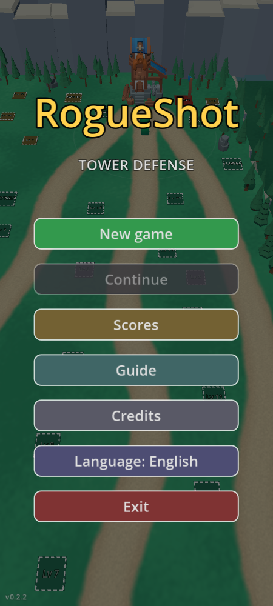
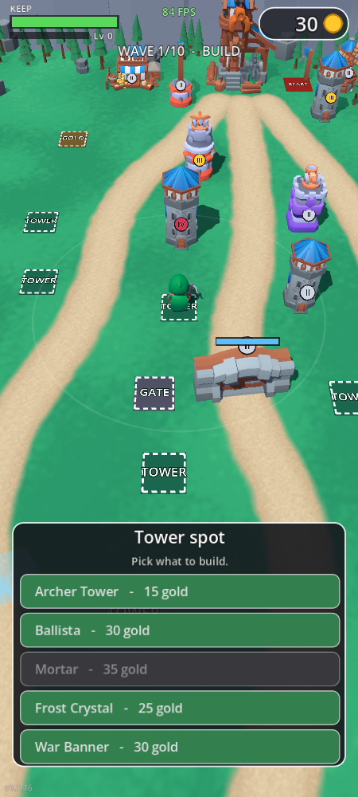
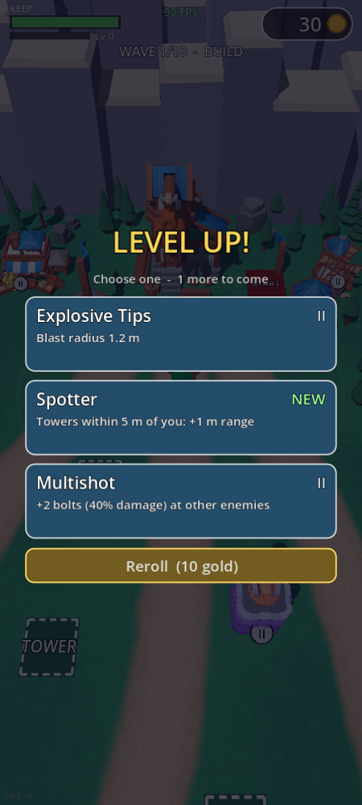
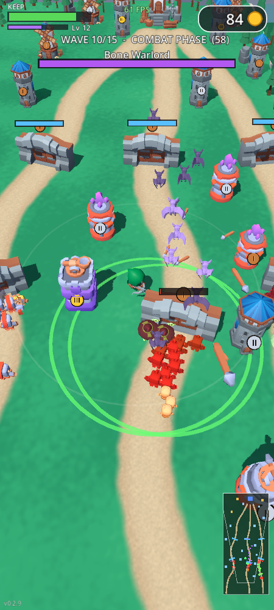

# RogueShot TD

**RogueShot Tower Defense** is a 3D low-poly tower defense for Android phones (and
Windows PC), built with [Godot 4.7](https://godotengine.org). You play a crossbow
rogue who walks the map, builds and upgrades towers on fixed spots between waves,
and grows stronger with rogue-like upgrade cards. It started as a recreation of the
level in *Kingshot*'s ads and now follows *Thronefall*'s defense system.

A personal project, built by directing Claude (Claude Code) with free CC0 asset
packs. Not published anywhere.

| | | | |
|:--:|:--:|:--:|:--:|
|  |  |  |  |
| Menu | Build phase | Level up | Battle |

## How to play

- **Move** by dragging anywhere (a floating joystick; on PC: mouse drag or WASD).
  The hero shoots the nearest enemy by himself, also while running. Dropped
  gold (coins, stacks, ingots) is yours: walk over it, and when the wave
  ends every coin left flies to you.
- **Build phase:** step onto a spot and its menu pops up. **Tower spots** take
  any tower (tap one to see its range, tap again to build) (4 levels, shown by a I-IV badge), **gate spots** wall off a lane,
  **gold plots** take a farm or a bank. Stand on the red **START** pad for 5 s
  to begin the next wave; walk off to cancel.
- **Attack phase:** three lanes march on the keep. Enemies batter gates, then
  the keep itself; lose when the keep's HP runs out, win by clearing 10 waves.
- **Hero upgrades:** kills near the hero (his or a tower's) give XP, shown
  as "+N XP" over his head. After each
  wave, pick 1 of 3 cards per level (drawing one you own raises its tier;
  reroll for gold), plus a relic after waves 3, 6 and 9: lightning, a spirit
  wisp, twin crossbow...
- **Languages:** English and Traditional Chinese (繁體中文); switch from
  the title menu.
- **Saves and scores:** the game saves at every wave; Continue from the menu.
  The top 10 rank by waves cleared, then keep HP and gold left.

| Building | What it does |
|---|---|
| Archer Tower | Cheap, quick single-target arrows |
| Ballista | Slow heavy bolt that pierces a whole line |
| Mortar | Lobs boulders that splash a group; can't hit up close |
| Frost Crystal | Pulse that slows walking and attacks nearby |
| War Banner | No attack; towers and the hero in its ring attack faster |
| Farm / Bank | Gold after every wave: a fixed amount, or interest on what you hold (capped) |
| Gate | Blocks its lane until broken; repaired after each wave |

Enemies: grunts, armoured soldiers (light hits barely scratch them), fast
runners, giant barbarians (who shove the small ones aside at a gate), bats
that fly over gates, skeleton crossbowmen that shoot gates from range,
and the Bone Warlord boss in wave 10. They get tougher every wave.

## Building and running

- **PC:** open the folder in Godot 4.7 and press Play, or `./build.sh export`
  for a Windows `.exe` (the window fits 90% of the screen height).
- **Android:** `./build.sh apk` builds a debug APK (JDK 17 and the Android SDK
  set in Godot's editor settings); copy it to the phone and tap it. Newer
  builds install over older ones.
- `./build.sh test` runs the headless rule tests (including a bot playing all
  10 waves), `sim` a balance timeline, `shot` a screenshot; see the top of
  `build.sh`. Development notes: [CLAUDE.md](CLAUDE.md); design:
  [docs/DESIGN.md](docs/DESIGN.md).

## Tech notes

- All rules live in node-free scripts (`scripts/sim.gd`, `horde.gd`,
  `perks.gd`), so tests and balance runs play whole games headlessly in
  seconds; the view draws between 60 Hz rule steps for smooth motion.
- Hundreds of animated enemies are one MultiMesh per type with animations
  baked into vertex-animation textures (`tools/bake_vat.gd`,
  `shaders/vat.gdshader`): 60 fps on a mid-range phone (Mali-G68).
- Compatibility renderer (OpenGL ES 3) on every platform.

## Credits

- 3D models (CC0): [Kenney](https://kenney.nl) (Tower Defense Kit, Mini
  Dungeon, Mini Arena, Nature Kit), [Kay Lousberg / KayKit](https://kaylousberg.com)
  (Adventurers, Skeletons, Medieval Hexagon, Forest Nature, Dungeon
  Remastered) and [Quaternius](https://quaternius.com) (Animated Monsters: bat).
- Sound effects: Kenney and OpenGameArt contributors, CC0; the wave horn is
  "Scary Echoey Horn Esque Sound" by Kat (CC-BY 4.0). Full list in
  [assets/sfx/CREDITS.txt](assets/sfx/CREDITS.txt).
- Font: [Noto Sans TC](https://fonts.google.com/noto/specimen/Noto+Sans+TC)
  (SIL Open Font License, `assets/fonts/OFL.txt`).
- Music: "RPG City" by phantasticbeats via [Pixabay](https://pixabay.com)
  (Pixabay Content License; included for the game only).
- Engine: [Godot Engine](https://godotengine.org) (MIT).

## License

The code is under the [MIT License](LICENSE). The assets keep their own
licences (see Credits; the background music may not be redistributed on
its own).
